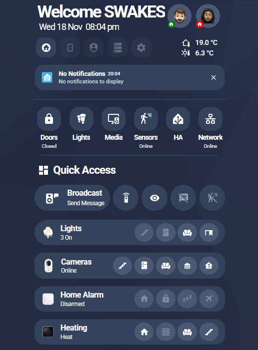
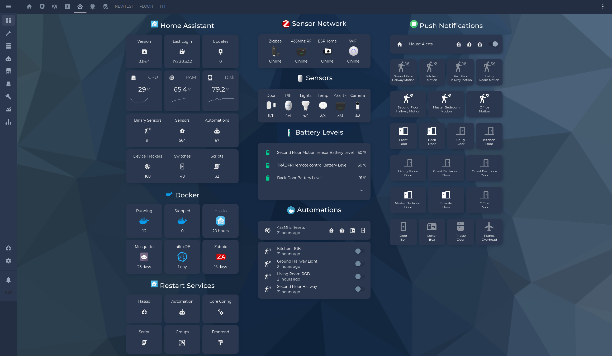
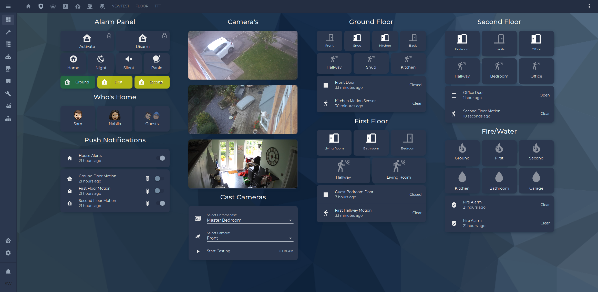
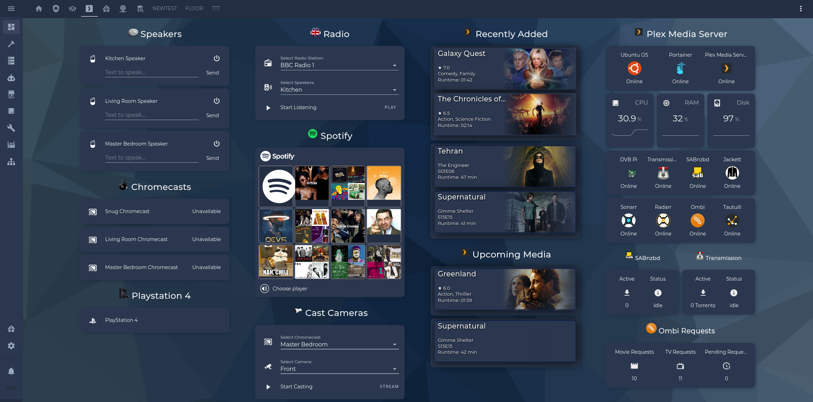
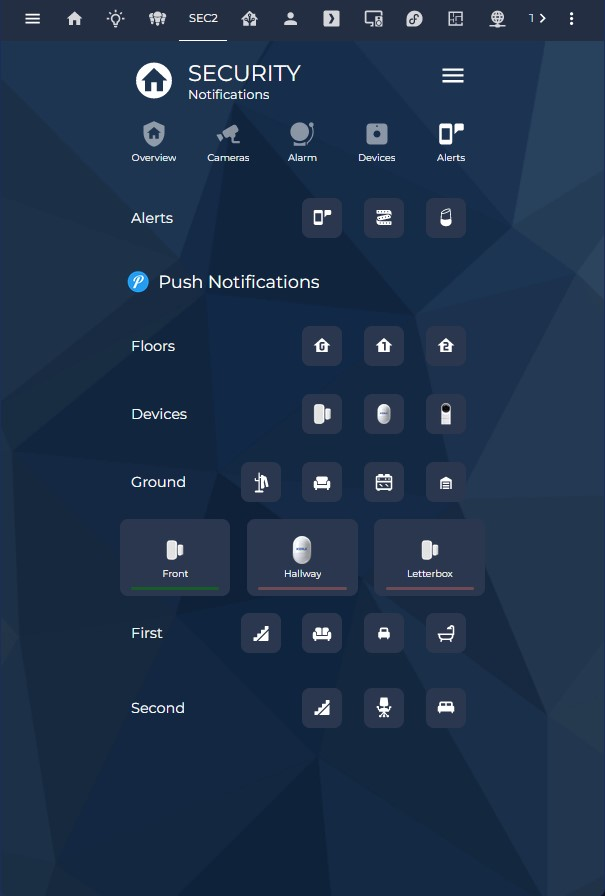
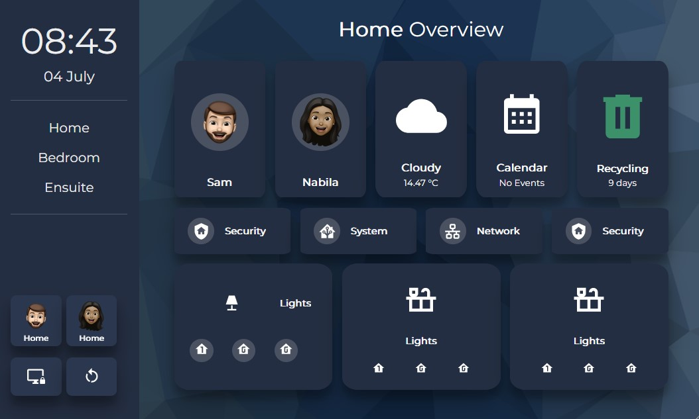

# SWAKES - Home Assistant

 

My Home Assistant dashboards, guides, themes and config, shared so you can borrow ideas for your own setup.

  

 

> [!TIP]
> Looking for the latest mobile dashboard? Start with the **[Yet Another Mobile Dashboard Redesign](guides/Yet%20Another%20Mobile%20Dashboard%20Redesign)** guide (October 2025).

 

## Contents

- [What's new](#whats-new)
- [Guides](#guides)
- [Screenshots](#screenshots)
- [What's in this repo](#whats-in-this-repo)
- [Using this config](#using-this-config)
- [Current setup](#current-setup)
  - [Platform](#platform)
  - [Add-ons](#add-ons)
  - [Integrations](#integrations)
  - [HACS](#hacs)
- [Hardware](#hardware)
- [Links and support](#links-and-support)

 

## What's new

| Date | Update |
| --- | --- |
| 18/11/2026 | README rewritten to match the current setup |
| 21/10/2025 | [Yet Another Mobile Dashboard Redesign](guides/Yet%20Another%20Mobile%20Dashboard%20Redesign) guide |
| 13/02/2023 | [Refresh 2.0](guides/Refresh%202.0) guide with the "mini bar" breakdown |
| 16/10/2020 | [Dashboards](dashboards) and screenshots |

 

## Guides

| Guide | What it covers |
| --- | --- |
| [Yet Another Mobile Dashboard Redesign](guides/Yet%20Another%20Mobile%20Dashboard%20Redesign) | 2025 phone dashboard: header card, stacked notifications, status row, broadcast messages, TV remote and button rows |
| [Light Dashboard 2.0](guides/Light%20Dashboard%202.0/YAML) | Floor-by-floor light dashboard built from `button-card`, `state-switch` and `input_select` menus |
| [Refresh 2.0](guides/Refresh%202.0/mini_bar.md) | The five-button "mini bar" built with `button-card` grid layouts |
| [Another Redesign](guides/Another%20Redesign/Light%20Card%20Example) | Single light card example |
| [Blog Examples](guides/Blog%20Examples/livingroom_tv_honeycomb_menu) | Living room TV honeycomb menu from the blog |

 

## Screenshots

<table>
  <tr>
    <td></td>
    <td></td>
  </tr>
  <tr>
    <td align="center">System</td>
    <td align="center">Lights</td>
  </tr>
  <tr>
    <td></td>
    <td></td>
  </tr>
  <tr>
    <td align="center">Security</td>
    <td align="center">Media</td>
  </tr>
</table>

<b>Security dashboard (mobile)</b>

 

  
  
  
  

<b>Older work in progress</b>

 

  
  

More in the [screenshots](screenshots) folder.

 

## What's in this repo

| Path | Contents |
| --- | --- |
| [`guides/`](guides) | Step-by-step dashboard guides with YAML and images |
| [`dashboards/`](dashboards) | Full dashboard YAML: lights, media, network, search, security and system (`*_updated.yaml` are the newer versions) |
| [`dashboards/mobile_dash/`](dashboards/mobile_dash) | Header, nav and phone cards from an earlier mobile dashboard |
| [`custom_elements/`](custom_elements) | Reusable `button-card` snippets |
| [`themes/`](themes) | Themes I've used or tweaked, including the SWAKES and Clear Dark variants |
| [`screenshots/`](screenshots) | Dashboard screenshots |
| [`configuration.yaml`](configuration.yaml), [`components/`](components), [`automations.yaml`](automations.yaml) | My older YAML config, split into packages |

> [!NOTE]
> The YAML config (`configuration.yaml`, `components/`, `automations.yaml`) dates from my 2020 to 2023 setup. My live instance is now mostly managed through the UI, so treat these files as examples rather than a working copy.

 

## Using this config

This is a reference, not a drop-in install. To reuse a card or dashboard:

1. Install the custom cards it uses through HACS. Each guide lists what it needs.
2. Copy the YAML into a dashboard in raw configuration editor mode.
3. Swap my entity IDs for your own. A missing entity will usually break a `button-card` layout.
4. Tweak sizes and padding. Most cards are tuned for a Google Pixel screen.

> [!IMPORTANT]
> Some files use `!secret` values, and some custom components, images and add-ons are referenced but not included. You'll need your own `secrets.yaml`.
 

## Current setup

### Platform

| | |
| --- | --- |
| Home Assistant | 2026.11 |
| Install type | Home Assistant OS 18 in a KVM virtual machine on Proxmox VE |
| Database | MariaDB (recorder) |
| Zigbee | Zigbee2MQTT with an SMLIGHT SLZB-06M coordinator |
| Thread / Matter | OpenThread Border Router and Matter Server |
| Remote access | Home Assistant Cloud (Nabu Casa) |
| Dashboards | 16 dashboards, about 90 views |

 

### Add-ons

| Area | Add-ons |
| --- | --- |
| Core | Mosquitto broker, MariaDB, Zigbee2MQTT, Matter Server, OpenThread Border Router, ESPHome Device Builder |
| Editing and backups | File editor, Terminal & SSH, Samba share, Home Assistant Editor, Home Assistant Version Control, Home Assistant Time Machine, Google Drive Backup |
| Presence and sensing | Everything Presence Zone Configurator, ESPresense Companion, TOMMY Zero, ESPectre Traffic Generator |
| Cameras and AI | Double Take Proxy, VisionState, Gemini Architect, openWakeWord |
| Devices | Ring-MQTT with Video Streaming, TasmoAdmin, SWPanel (my ESPHome LVGL panel designer) |
| Tools | AppDaemon, MQTT Explorer, SQLite Web, Bookstack, Beszel Agent, HAPass, Hearth |

 

### Integrations

Around 300 config entries. The main ones:

| Area | Integrations |
| --- | --- |
| Lighting and Zigbee | Zigbee2MQTT (MQTT), SMLIGHT, Yeelight, TP-Link Kasa, Tasmota, WLED, Broadlink, Matter, Thread, Xiaomi BLE |
| Security and cameras | UniFi Protect, Frigate, Ring, Alarmo, LLM Vision, Whodunnit |
| Network and servers | UniFi Network, AdGuard Home, Proxmox VE, Portainer, PiKVM, Cloudflare, Nmap Tracker, Network Scanner, Ping |
| Media | Plex, Tautulli, Sonarr, Radarr, Overseerr, SABnzbd, Transmission, Spotify, Google Cast, Samsung TV, Xbox, Radio Browser |
| Appliances and climate | Home Connect (Bosch), LG ThinQ, SmartThings, Google Nest, Honeywell Lyric |
| AI and voice | Anthropic (Claude), OpenAI, Google Gemini, Google Assistant, Chime TTS, VoIP, MCP Server |
| Info and helpers | Met Office, OpenWeatherMap, Waste Collection Schedule, Kleenex Pollen Radar, Flightradar24, 17TRACK, Waze Travel Time, Google Calendar, Pushover, Battery Notes, Watchman, Spook, pyscript |

 

### HACS

81 items installed through HACS. My own projects are marked ★.

#### Integrations (37)

<b>Dashboards and UI</b> (8)

| Name | What it does |
| --- | --- |
| [browser_mod](https://github.com/thomasloven/hass-browser_mod) | Turns each browser into a device you can control, with pop-ups |
| [Bubble Card Tools](https://github.com/Clooos/Bubble-Card-Tools) | Backend for Bubble Card modules |
| [Card Builder](https://github.com/studiobts/home-assistant-card-builder) | Build custom cards in a visual editor |
| [Custom Icons](https://github.com/thomasloven/hass-custom_icons) | Use your own SVG icons |
| [DashCast](https://github.com/AlexxIT/DashCast) | Cast dashboards to Chromecast devices |
| [Favicon changer](https://github.com/thomasloven/hass-favicon) | Change the browser tab icon and title |
| [Fluvy](https://github.com/acosta290/fluvy) | Theme and card library |
| [NeonPlan 3D](https://github.com/Mastershort/neonplan3d) | Interactive 3D floor plan |

<b>Automation and scripting</b> (5)

| Name | What it does |
| --- | --- |
| [C.A.F.E.](https://github.com/FezVrasta/cafe-hass) | Visual automation editor |
| [pyscript](https://github.com/custom-components/pyscript) | Write automations in Python |
| [Spook](https://github.com/frenck/spook) | Extra actions, helpers and repair checks |
| [Lighting Zone](https://github.com/rickmoonex/hass-lighting-zone) | Group lights into zones within an area |
| [Climate Group](https://github.com/bjrnptrsn/climate_group) | Group thermostats into one entity (archived upstream) |

<b>Monitoring and maintenance</b> (9)

| Name | What it does |
| --- | --- |
| [HAGHS](https://github.com/HA-Pulse/home-assistant-global-health-score) | Overall health score for the instance |
| [Watchman](https://github.com/dummylabs/thewatchman) | Finds missing entities and actions in config |
| [Upgrade Advisor](https://github.com/brianegge/ha-upgrade-advisor) | Checks release notes against your setup before upgrading |
| [Maintenance Supporter](https://github.com/iluebbe/maintenance_supporter) | Tracks household maintenance tasks |
| [FileTrack](https://github.com/TheScubaDiver/FileTrack) | Monitors files for changes |
| [Data Points](https://github.com/buggedcom/HASS-Data-Points) | Records timestamped events for charts |
| [HA Percyta](https://github.com/jayjojayson/HA_Percyta) | Audits users, permissions and data access |
| [Whodunnit](https://github.com/sfox38/WhoDunnit) | Shows who or what caused each state change |
| [Claude Usage](https://github.com/trickv/hass-claude-usage) | Tracks Claude subscription usage |

<b>Notifications</b> (2)

| Name | What it does |
| --- | --- |
| [Notify Studio ★](https://github.com/pqpxo/ha-notify-studio) | Build, test and template Companion app notifications |
| [Universal Notifier](https://github.com/jumping2000/universal_notifier) | One action to send to every notification service |

<b>Cameras and AI</b> (4)

| Name | What it does |
| --- | --- |
| [LLM Vision](https://github.com/valentinfrlch/ha-llmvision) | AI descriptions of camera images and events |
| [WebRTC Camera](https://github.com/AlexxIT/WebRTC) | Low-latency camera streams |
| [Scrypted](https://github.com/koush/ha_scrypted) | Scrypted camera and NVR integration |
| [Frigate Config Builder](https://github.com/ojiudezue/frigate-config-builder) | Generates Frigate config from Home Assistant |

<b>Devices and services</b> (9)

| Name | What it does |
| --- | --- |
| [Home Connect Alt](https://github.com/ekutner/home-connect-hass) | Bosch and Siemens appliances |
| [SamsungTV Smart](https://github.com/ollo69/ha-samsungtv-smart) | Samsung TV control with SmartThings |
| [HASS.Agent 2](https://github.com/hass-agent/HASS.Agent-Integration) | Windows PC sensors, media and notifications |
| [JetKVM](https://github.com/Poshy163/HomeAssistant-JetKVM) | JetKVM remote KVM control |
| [TOMMY](https://github.com/tommy-sense/homeassistant-integration) | Wi-Fi motion sensing zones |
| [Network Scanner](https://github.com/parvez/network_scanner) | Lists every device on the LAN |
| [Arr Stack Integration](https://github.com/martinargalas/arr-stack-integration) | Backend for the Arr Stack Card |
| [Flightradar24](https://github.com/AlexandrErohin/home-assistant-flightradar24) | Flights passing overhead |
| [Kleenex Pollen Radar](https://github.com/MarcoGos/kleenex_pollenradar) | Local pollen levels |

#### Frontend cards (43)

<b>Layout and navigation</b> (12)

| Name | What it does |
| --- | --- |
| [layout-card](https://github.com/thomasloven/lovelace-layout-card) | Grid, masonry and column layouts |
| [Bubble Card](https://github.com/Clooos/Bubble-Card) | Pop-ups and minimalist cards |
| [Navbar card](https://github.com/joseluis9595/lovelace-navbar-card) | Bottom nav bar on phones, side nav on desktop |
| [Simple Swipe Card](https://github.com/nutteloost/simple-swipe-card) | Swipe between cards |
| [Collapsable cards](https://github.com/RossMcMillan92/lovelace-collapsable-cards) | Hide cards behind a dropdown |
| [FAB Card](https://github.com/bhuebschen/fab-card) | Floating action button |
| [Honeycomb Menu](https://github.com/Sian-Lee-SA/honeycomb-menu) | Hexagon pop-up menu on any card |
| [state-switch](https://github.com/thomasloven/lovelace-state-switch) | Show different cards depending on a state |
| [hui-element](https://github.com/thomasloven/lovelace-hui-element) | Use built-in cards and rows anywhere |
| [Nodalia Cards](https://github.com/danielmigueltejedor/nodalia-cards) | Card set with a shared design system |
| [My Cards Bundle](https://github.com/AnthonMS/my-cards) | Sliders and buttons |
| [Custom Features for Home Assistant Cards](https://github.com/Nerwyn/custom-card-features) | Extra buttons, sliders and dropdowns on tile cards |

<b>Rooms and lights</b> (6)

| Name | What it does |
| --- | --- |
| [area-card-plus](https://github.com/xBourner/area-card-plus) | Room cards with status and controls |
| [status-card](https://github.com/xBourner/status-card) | Summary of what's on, open or active |
| [Light Pills Card ★](https://github.com/pqpxo/ha-light-pills-card) | Compact room card with 2 to 4 light pills |
| [Paper Buttons Row](https://github.com/jcwillox/lovelace-paper-buttons-row) | Rows of styled action buttons |
| [template-entity-row](https://github.com/thomasloven/lovelace-template-entity-row) | Entity rows with templated content |
| [Text Divider Row](https://github.com/iantrich/text-divider-row) | Text dividers inside entity cards |

<b>Media</b> (5)

| Name | What it does |
| --- | --- |
| [Mediocre Hass Media Player Cards](https://github.com/antontanderup/mediocre-hass-media-player-cards) | Media player cards |
| [Grid Remote Card](https://github.com/thecodingdad/grid-remote-card) | TV remote built on a grid |
| [Recently Added Media Card](https://github.com/rusty4444/recently-added-media-card) | Latest Plex films and episodes |
| [Arr Stack Card](https://github.com/martinargalas/ha-arr-stack-card) | Sonarr, Radarr and download queue in one card |
| [ha-catt-fix](https://github.com/swiergot/ha-catt-fix) | Stops dashboards timing out when cast |

<b>Cameras and people</b> (2)

| Name | What it does |
| --- | --- |
| [Camera Gallery Card](https://github.com/TheScubaDiver/camera-gallery-card) | Browse camera snapshots and clips |
| [Person Tracker Card](https://github.com/djdevil/person-tracker-card) | Where everyone is, with battery and status |

<b>Calendars, timers and to-do</b> (6)

| Name | What it does |
| --- | --- |
| [Atomic Calendar Revive](https://github.com/totaldebug/atomic-calendar-revive) | Calendar card |
| [Calendar Card Pro](https://github.com/alexpfau/calendar-card-pro) | Clean, fast calendar card |
| [Chronicle Card](https://github.com/KadenThomp36/chronicle-card) | Timeline of events from any source |
| [Simple Timer Card](https://github.com/eyalgal/simple-timer-card) | Timers in several styles |
| [TimeFlow Card](https://github.com/Rishi8078/TimeFlow-Card) | Countdown with a progress ring |
| [Todo Swipe Card](https://github.com/nutteloost/todo-swipe-card) | Swipe between to-do lists |

<b>Weather and data</b> (6)

| Name | What it does |
| --- | --- |
| [Simple Weather Card](https://github.com/kalkih/simple-weather-card) | Minimal weather card |
| [Hourly Weather Card](https://github.com/decompil3d/lovelace-hourly-weather) | Hourly forecast as a coloured bar |
| [mini-graph-card](https://github.com/kalkih/mini-graph-card) | Small sensor graphs |
| [Flex Table](https://github.com/custom-cards/flex-table-card) | Tables built from any entities |
| [Flightradar Flight Card](https://github.com/plckr/flightradar-flight-card) | Flights from the Flightradar24 integration |
| [Raptor Orbit Card](https://github.com/Inter-Raptor/raptor-orbit-card) | Raptor Orbit card |

<b>Network and system</b> (5)

| Name | What it does |
| --- | --- |
| [AdGuard Card](https://github.com/homeassistant-extras/adguard-card) | AdGuard Home stats and controls |
| [UniFi Device Card](https://github.com/bluenazgul/unifi-device-card) | UniFi gateways, switches and APs |
| [System Monitor Card](https://github.com/juju35/ha-system-monitor-card) | CPU, memory and disk of the host |
| [AlertTicker Card](https://github.com/djdevil/AlertTicker-Card) | Scrolling alerts and notifications |
| [Entity Exporter Card](https://github.com/marc-schuetze/ha-entity-exporter-card) | Export entity lists |

<b>Icons</b> (1)

| Name | What it does |
| --- | --- |
| [Custom brand icons](https://github.com/elax46/custom-brand-icons) | Brand icons missing from MDI |

#### Theme

[Origami](https://github.com/hazymorning/origami), built mainly with Bubble Card.

 

## Hardware

### Lights

| Device | Connection | Qty |
| --- | --- | :---: |
| IKEA TRADFRI GU10, white spectrum | Zigbee | 36 |
| IKEA TRADFRI GU10, colour and white spectrum | Zigbee | 6 |
| IKEA TRADFRI E27 (various) | Zigbee | 6 |
| Philips Hue White A60 E27 | Zigbee | 2 |
| Lidl Livarno Lux GU10 RGB | Zigbee | 1 |
| Yeelight bulbs | Wi-Fi | |
| WS2812B LED strips | Wi-Fi (WLED / ESPHome) | |

### Sensors

| Device | Connection | Qty |
| --- | --- | :---: |
| Aqara door and window sensor | Zigbee | 18 |
| Aqara temperature and humidity sensor | Zigbee | 9 |
| IKEA TRADFRI motion sensor | Zigbee | 4 |
| IKEA VALLHORN motion sensor | Zigbee | 4 |
| SONOFF motion sensor | Zigbee | 4 |
| Philips Hue outdoor motion sensor | Zigbee | 2 |
| IKEA BADRING water leak sensor | Zigbee | 2 |
| IKEA VINDSTYRKA air quality sensor | Zigbee | 1 |
| IKEA MYGGSPRAY motion sensor | Matter over Thread | 1 |
| Everything Presence One / Lite (mmWave) | Wi-Fi (ESPHome) | |
| ESPresense BLE nodes | Wi-Fi (MQTT) | 3 |
| BirdNET-Go audio analysers | Wi-Fi (MQTT) | 3 |

### Switches and plugs

| Device | Connection | Qty |
| --- | --- | :---: |
| Aqara H1 wall switch (double rocker, no neutral) | Zigbee | 1 |
| UseeLink 4-gang power strip with USB | Zigbee | 1 |
| IKEA TOFSMYGGA/GRILLPLATS smart plug | Zigbee | 1 |
| Lidl Silvercrest smart plug | Zigbee | 1 |
| SmartThings outlet with power meter | Zigbee | 1 |
| TP-Link Kasa smart plugs | Wi-Fi | |

### Remotes

| Device | Connection | Qty |
| --- | --- | :---: |
| IKEA TRADFRI on/off switch | Zigbee | 4 |
| IKEA STYRBAR remote | Zigbee | 2 |
| IKEA RODRET dimmer | Zigbee | 2 |
| Broadlink RM4 (IR/RF) | Wi-Fi | 1 |

### Security and cameras

| Device | Connection | Qty |
| --- | --- | :---: |
| UniFi Protect cameras (G5 Turret Ultra, G5 Dome, G3 Instant) | LAN (UniFi Protect) | |
| Ring Video Doorbell 3 | Wi-Fi (Ring-MQTT) | 1 |
| Ring Alarm base station and keypads | Wi-Fi / Z-Wave (Ring-MQTT) | 1 + 2 |
| Ring contact and motion sensors | Z-Wave (Ring-MQTT) | 4 |

### Network and servers

| Device | Connection |
| --- | --- |
| UniFi Dream Machine Pro | LAN (UniFi) |
| UniFi switches and access points | LAN (UniFi) |
| SMLIGHT SLZB-06M Zigbee coordinator | LAN |
| IKEA TRADFRI signal repeater | Zigbee |
| Proxmox VE host | LAN |
| PiKVM and JetKVM | LAN |

### Appliances and media

| Device | Connection |
| --- | --- |
| Bosch dishwasher | Wi-Fi (Home Connect) |
| LG fridge freezer | Wi-Fi (LG ThinQ) |
| Samsung QE65Q80D TV | Wi-Fi (Samsung TV) |
| Xbox | Wi-Fi (Xbox) |
| Google Nest / Home speakers and Chromecasts | Wi-Fi (Google Cast) |
| Aqara Smart Pet Feeder C1 | Zigbee |

 

## Links and support

- [SWAKES blog](https://makes.swakes.co.uk/tag/home-assistant/)
- [Reddit](https://old.reddit.com/user/swake88/)
- [Home Assistant Community](https://community.home-assistant.io/u/pqpxd/summary)
- [Home Assistant Facebook group](https://www.facebook.com/groups/HomeAssistant)

If you've found something useful here, you can [buy me a coffee](https://www.buymeacoffee.com/swakes).
