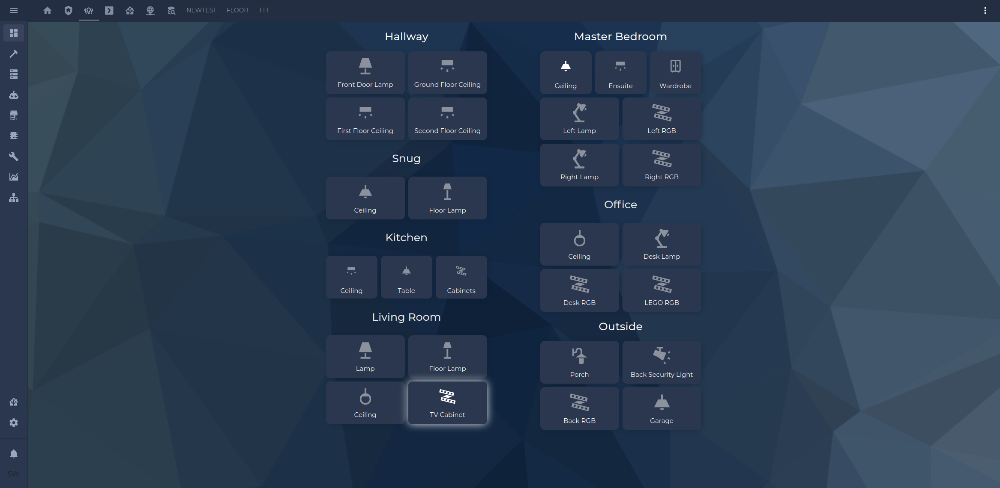
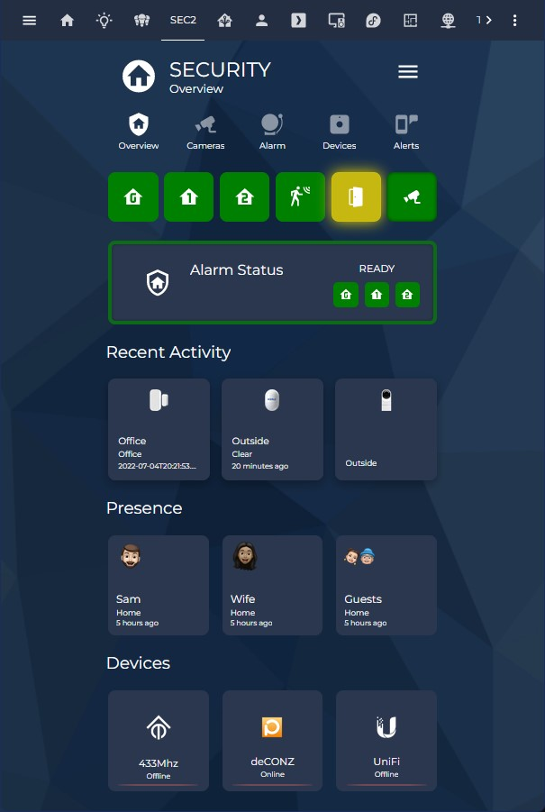
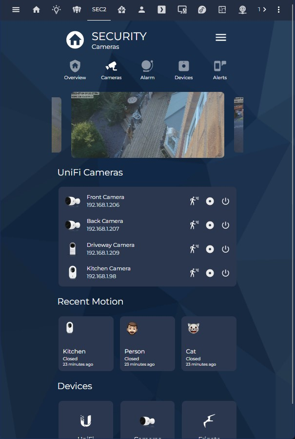
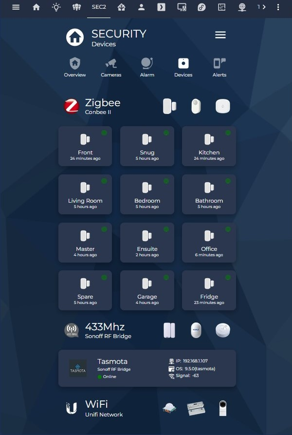
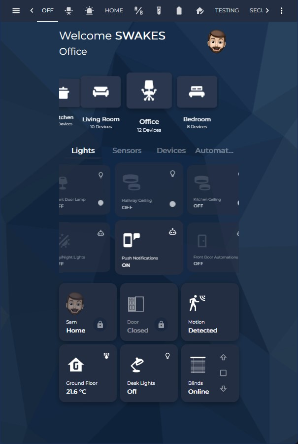

# SWAKES - Home Assistant

 

My Home Assistant dashboards, guides, themes and config, shared so you can borrow ideas for your own setup.

  
  &nbsp;&nbsp;
  

 

> [!TIP]
> Looking for the latest mobile dashboard? Start with the **[Yet Another Mobile Dashboard Redesign](guides/Yet%20Another%20Mobile%20Dashboard%20Redesign)** guide (October 2025).

 

## Contents

- [What's new](#whats-new)
- [Guides](#guides)
- [Screenshots](#screenshots)
- [What's in this repo](#whats-in-this-repo)
- [Using this config](#using-this-config)
- [Current setup](#current-setup)
  - [Platform](#platform)
  - [Add-ons](#add-ons)
  - [Integrations](#integrations)
  - [HACS](#hacs)
- [Hardware](#hardware)
- [Links and support](#links-and-support)

 

## What's new

| Date | Update |
| --- | --- |
| 18/11/2026 | README rewritten to match the current setup |
| 21/10/2025 | [Yet Another Mobile Dashboard Redesign](guides/Yet%20Another%20Mobile%20Dashboard%20Redesign) guide |
| 13/02/2023 | [Refresh 2.0](guides/Refresh%202.0) guide with the "mini bar" breakdown |
| 16/10/2020 | [Dashboards](dashboards) and screenshots |

 

## Guides

| Guide | What it covers |
| --- | --- |
| [Yet Another Mobile Dashboard Redesign](guides/Yet%20Another%20Mobile%20Dashboard%20Redesign) | 2025 phone dashboard: header card, stacked notifications, status row, broadcast messages, TV remote and button rows |
| [Light Dashboard 2.0](guides/Light%20Dashboard%202.0/YAML) | Floor-by-floor light dashboard built from `button-card`, `state-switch` and `input_select` menus |
| [Refresh 2.0](guides/Refresh%202.0/mini_bar.md) | The five-button "mini bar" built with `button-card` grid layouts |
| [Another Redesign](guides/Another%20Redesign/Light%20Card%20Example) | Single light card example |
| [Blog Examples](guides/Blog%20Examples/livingroom_tv_honeycomb_menu) | Living room TV honeycomb menu from the blog |

 

## Screenshots

<table>
  <tr>
    <td></td>
    <td></td>
  </tr>
  <tr>
    <td align="center">System</td>
    <td align="center">Lights</td>
  </tr>
  <tr>
    <td></td>
    <td></td>
  </tr>
  <tr>
    <td align="center">Security</td>
    <td align="center">Media</td>
  </tr>
</table>

<b>Security dashboard (mobile)</b>

 

  
  
  
  

<b>Older work in progress</b>

 

  
  

More in the [screenshots](screenshots) folder.

 

## What's in this repo

| Path | Contents |
| --- | --- |
| [`guides/`](guides) | Step-by-step dashboard guides with YAML and images |
| [`dashboards/`](dashboards) | Full dashboard YAML: lights, media, network, search, security and system (`*_updated.yaml` are the newer versions) |
| [`dashboards/mobile_dash/`](dashboards/mobile_dash) | Header, nav and phone cards from an earlier mobile dashboard |
| [`custom_elements/`](custom_elements) | Reusable `button-card` snippets |
| [`themes/`](themes) | Themes I've used or tweaked, including the SWAKES and Clear Dark variants |
| [`screenshots/`](screenshots) | Dashboard screenshots |
| [`configuration.yaml`](configuration.yaml), [`components/`](components), [`automations.yaml`](automations.yaml) | My older YAML config, split into packages |

> [!NOTE]
> The YAML config (`configuration.yaml`, `components/`, `automations.yaml`) dates from my 2020 to 2023 setup. My live instance is now mostly managed through the UI, so treat these files as examples rather than a working copy.

 

## Using this config

This is a reference, not a drop-in install. To reuse a card or dashboard:

1. Install the custom cards it uses through HACS. Each guide lists what it needs.
2. Copy the YAML into a dashboard in raw configuration editor mode.
3. Swap my entity IDs for your own. A missing entity will usually break a `button-card` layout.
4. Tweak sizes and padding. Most cards are tuned for a Google Pixel screen.

> [!IMPORTANT]
> Some files use `!secret` values, and some custom components, images and add-ons are referenced but not included. You'll need your own `secrets.yaml`.
 

## Current setup

### Platform

| | |
| --- | --- |
| Home Assistant | 2026.11 |
| Install type | Home Assistant OS 18 in a KVM virtual machine on Proxmox VE |
| Database | MariaDB (recorder) |
| Zigbee | Zigbee2MQTT with an SMLIGHT SLZB-06M coordinator |
| Thread / Matter | OpenThread Border Router and Matter Server |
| Remote access | Home Assistant Cloud (Nabu Casa) |
| Dashboards | 16 dashboards, about 90 views |

 

### Add-ons

| Area | Add-ons |
| --- | --- |
| Core | Mosquitto broker, MariaDB, Zigbee2MQTT, Matter Server, OpenThread Border Router, ESPHome Device Builder |
| Editing and backups | File editor, Terminal & SSH, Samba share, Home Assistant Editor, Home Assistant Version Control, Home Assistant Time Machine, Google Drive Backup |
| Presence and sensing | Everything Presence Zone Configurator, ESPresense Companion, TOMMY Zero, ESPectre Traffic Generator |
| Cameras and AI | Double Take Proxy, VisionState, Gemini Architect, openWakeWord |
| Devices | Ring-MQTT with Video Streaming, TasmoAdmin, SWPanel (my ESPHome LVGL panel designer) |
| Tools | AppDaemon, MQTT Explorer, SQLite Web, Bookstack, Beszel Agent, HAPass, Hearth |

 

### Integrations

Around 300 config entries. The main ones:

| Area | Integrations |
| --- | --- |
| Lighting and Zigbee | Zigbee2MQTT (MQTT), SMLIGHT, Yeelight, TP-Link Kasa, Tasmota, WLED, Broadlink, Matter, Thread, Xiaomi BLE |
| Security and cameras | UniFi Protect, Frigate, Ring, Alarmo, LLM Vision, Whodunnit |
| Network and servers | UniFi Network, AdGuard Home, Proxmox VE, Portainer, PiKVM, Cloudflare, Nmap Tracker, Network Scanner, Ping |
| Media | Plex, Tautulli, Sonarr, Radarr, Overseerr, SABnzbd, Transmission, Spotify, Google Cast, Samsung TV, Xbox, Radio Browser |
| Appliances and climate | Home Connect (Bosch), LG ThinQ, SmartThings, Google Nest, Honeywell Lyric |
| AI and voice | Anthropic (Claude), OpenAI, Google Gemini, Google Assistant, Chime TTS, VoIP, MCP Server |
| Info and helpers | Met Office, OpenWeatherMap, Waste Collection Schedule, Kleenex Pollen Radar, Flightradar24, 17TRACK, Waze Travel Time, Google Calendar, Pushover, Battery Notes, Watchman, Spook, pyscript |

 

### HACS

<b>Integrations (37)</b>

 

Arr Stack Integration, browser_mod, Bubble Card Tools, C.A.F.E., Card Builder, Claude Usage, Climate Group, Custom Icons, DashCast, Data Points, Favicon changer, FileTrack, Flightradar24, Fluvy, Frigate Config Builder, HA Percyta, HAGHS, HASS.Agent 2, Home Connect Alt, JetKVM, Kleenex Pollen Radar, Lighting Zone, LLM Vision, Maintenance Supporter, NeonPlan 3D, Network Scanner, Notify Studio, pyscript, SamsungTV Smart, Scrypted, Spook, TOMMY, Universal Notifier, Upgrade Advisor, Watchman, WebRTC Camera, Whodunnit

<b>Frontend cards (43)</b>

 

AdGuard Card, AlertTicker Card, area-card-plus, Arr Stack Card, Atomic Calendar Revive, Bubble Card, Calendar Card Pro, Camera Gallery Card, Chronicle Card, Collapsable cards, Custom brand icons, Custom Features for Home Assistant Cards, Entity Exporter Card, FAB Card, Flex Table, Flightradar Flight Card, Grid Remote Card, ha-catt-fix, Honeycomb Menu, Hourly Weather Card, hui-element, layout-card, Light Pills Card, Mediocre Hass Media Player Cards, mini-graph-card, My Cards Bundle, Navbar card, Nodalia Cards, Paper Buttons Row, Person Tracker Card, raptor orbit card, Recently Added Media Card, Simple Swipe Card, Simple Timer Card, Simple Weather Card, state-switch, status-card, System Monitor Card, template-entity-row, Text Divider Row, TimeFlow Card, Todo Swipe Card, UniFi Device Card

<b>Themes (1)</b>

 

Origami

 

## Hardware

### Lights

| Device | Connection | Qty |
| --- | --- | :---: |
| IKEA TRADFRI GU10, white spectrum | Zigbee | 36 |
| IKEA TRADFRI GU10, colour and white spectrum | Zigbee | 6 |
| IKEA TRADFRI E27 (various) | Zigbee | 6 |
| Philips Hue White A60 E27 | Zigbee | 2 |
| Lidl Livarno Lux GU10 RGB | Zigbee | 1 |
| Yeelight bulbs | Wi-Fi | |
| WS2812B LED strips | Wi-Fi (WLED / ESPHome) | |

### Sensors

| Device | Connection | Qty |
| --- | --- | :---: |
| Aqara door and window sensor | Zigbee | 18 |
| Aqara temperature and humidity sensor | Zigbee | 9 |
| IKEA TRADFRI motion sensor | Zigbee | 4 |
| IKEA VALLHORN motion sensor | Zigbee | 4 |
| SONOFF motion sensor | Zigbee | 4 |
| Philips Hue outdoor motion sensor | Zigbee | 2 |
| IKEA BADRING water leak sensor | Zigbee | 2 |
| IKEA VINDSTYRKA air quality sensor | Zigbee | 1 |
| IKEA MYGGSPRAY motion sensor | Matter over Thread | 1 |
| Everything Presence One / Lite (mmWave) | Wi-Fi (ESPHome) | |
| ESPresense BLE nodes | Wi-Fi (MQTT) | 3 |
| BirdNET-Go audio analysers | Wi-Fi (MQTT) | 3 |

### Switches and plugs

| Device | Connection | Qty |
| --- | --- | :---: |
| Aqara H1 wall switch (double rocker, no neutral) | Zigbee | 1 |
| UseeLink 4-gang power strip with USB | Zigbee | 1 |
| IKEA TOFSMYGGA/GRILLPLATS smart plug | Zigbee | 1 |
| Lidl Silvercrest smart plug | Zigbee | 1 |
| SmartThings outlet with power meter | Zigbee | 1 |
| TP-Link Kasa smart plugs | Wi-Fi | |

### Remotes

| Device | Connection | Qty |
| --- | --- | :---: |
| IKEA TRADFRI on/off switch | Zigbee | 4 |
| IKEA STYRBAR remote | Zigbee | 2 |
| IKEA RODRET dimmer | Zigbee | 2 |
| Broadlink RM4 (IR/RF) | Wi-Fi | 1 |

### Security and cameras

| Device | Connection | Qty |
| --- | --- | :---: |
| UniFi Protect cameras (G5 Turret Ultra, G5 Dome, G3 Instant) | LAN (UniFi Protect) | |
| Ring Video Doorbell 3 | Wi-Fi (Ring-MQTT) | 1 |
| Ring Alarm base station and keypads | Wi-Fi / Z-Wave (Ring-MQTT) | 1 + 2 |
| Ring contact and motion sensors | Z-Wave (Ring-MQTT) | 4 |

### Network and servers

| Device | Connection |
| --- | --- |
| UniFi Dream Machine Pro | LAN (UniFi) |
| UniFi switches and access points | LAN (UniFi) |
| SMLIGHT SLZB-06M Zigbee coordinator | LAN |
| IKEA TRADFRI signal repeater | Zigbee |
| Proxmox VE host | LAN |
| PiKVM and JetKVM | LAN |

### Appliances and media

| Device | Connection |
| --- | --- |
| Bosch dishwasher | Wi-Fi (Home Connect) |
| LG fridge freezer | Wi-Fi (LG ThinQ) |
| Samsung QE65Q80D TV | Wi-Fi (Samsung TV) |
| Xbox | Wi-Fi (Xbox) |
| Google Nest / Home speakers and Chromecasts | Wi-Fi (Google Cast) |
| Aqara Smart Pet Feeder C1 | Zigbee |

 

## Links and support

- [SWAKES blog](https://makes.swakes.co.uk/tag/home-assistant/)
- [Reddit](https://old.reddit.com/user/swake88/)
- [Home Assistant Community](https://community.home-assistant.io/u/pqpxd/summary)
- [Home Assistant Facebook group](https://www.facebook.com/groups/HomeAssistant)

If you've found something useful here, you can [buy me a coffee](https://www.buymeacoffee.com/swakes).
